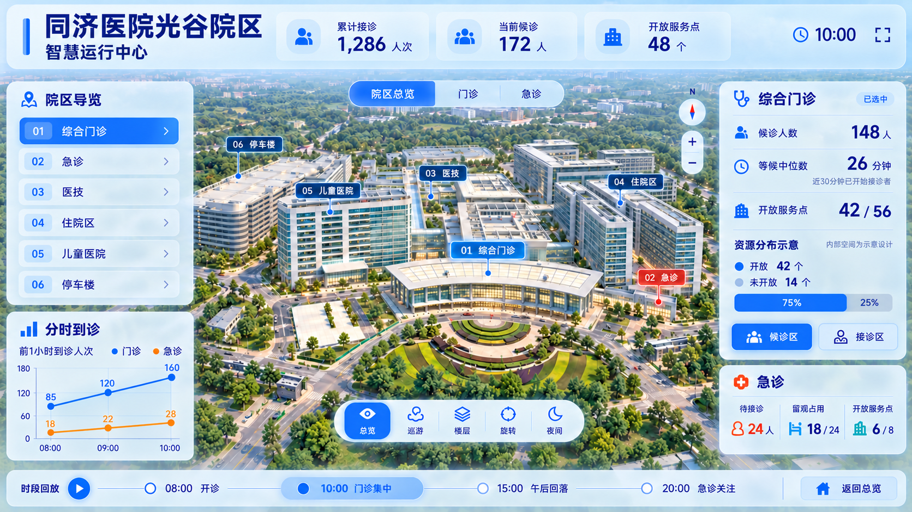

# 同济医院三维可视化大屏

以武汉同济医院光谷院区为参考的智慧运行中心演示项目，使用 React、TypeScript、Three.js 和 Vite，实现院区导览、区域定位、楼层示意、日夜切换和时段回放。

> **非医院官方项目。所有运行指标均为模拟数据，不代表医院真实运行情况。建筑尺寸根据公开及用户提供的参考资料估计；内部空间为示意设计，不能用于实际导航、医疗或运营决策。**



上图是视觉设计目标，并非当前网页实测。当前模型精细度与设计图仍有差距；Tripo 单体输入正在准备，尚未提交生成。

## 本地运行

建议使用 Node.js 22.12+ 或兼容的更新版本，以及 npm。

```bash
npm ci
npm run dev
```

打开终端提示的本地地址（默认 http://127.0.0.1:5173/）。

```bash
npm run typecheck
npm test
npm run build
npm run preview
```

前端无真实医院接口，不需要 API 密钥。构建产物位于 `dist`。

## GitHub Pages

工作流在 PR 中运行测试与生产构建；合入 `main` 后自动部署 `dist/`，也可在 Actions 手动触发。仓库 Settings → Pages 的 Source 需设为 GitHub Actions。

预定访问地址：https://xxcool.github.io/tongji-hospital-3d-dashboard/ （首次部署成功后生效）。

本地验证相同部署路径：

```bash
npm run build -- --base=/tongji-hospital-3d-dashboard/
npm run preview -- --base=/tongji-hospital-3d-dashboard/
```

只发布网页构建产物，Blender 源文件、设计资料与 Tripo 工具不进入站点。

## 功能

- 院区总览与门诊、急诊、医技、住院区、儿童医院、停车楼导览。
- 独立候诊/接诊示意区域定位，1F/2F楼层展开。
- 巡游、旋转、缩放与日夜切换。
- 08:00、10:00、15:00、20:00模拟时段及面板联动。
- 1920×1080逻辑画布等比适配，场景边界与面板对齐。

## 项目结构

| 路径 | 内容 |
|---|---|
| `src` | React 源码、三维场景、固定模拟数据与测试 |
| `docs/research` | 调研与范围建议 |
| `public/scene` | 网页GLB与场景绑定 |
| `assets/blender` | 当前可编辑模型及制作规格 |
| `docs/design` | 当前有效设计与进度记录 |
| `tools/tripo` | 拆分清单、结构参考和精细单体生成输入 |
| `docs/verification` | 页面验证截图 |

当前设计与进度见[方案说明](docs/design/方案说明.md)。

## 三维资产制作

几何、材质和楼层结构以 `assets/blender/tongji-current.blend` 为准，通过无头 Blender MCP 编辑和导出。保留业务对象、楼层与分区 ID，再更新网页 GLB 及对应绑定。

Tripo 准备资料见[制作说明](tools/tripo/README.md)。仓库保留拆件 `.blend`/`.glb`、原始场景、清单和参考图。需要重导时，在 Blender MCP 执行 `prepare_assets.py`，显式提供本仓库的 `PROJECT_ROOT` 路径；不要通过终端启动 Blender 脚本。

当前仓库支持前端构建与从保存场景继续编辑，不承诺从空场景完全重建全部资产。性能需在目标设备另行评估。

## 资料与使用说明

照片、建筑效果图及用户提供的参考资料仅用于本演示的外观研究，其权利归原权利人；未独立核实第三方素材的再分发或商业使用许可。AI生成图仅作设计参考，未核实的背面和内部不能视为真实建筑资料。医院名称与标识不表示官方授权或合作。

本仓库未授予第三方参考素材额外许可，也未声明项目采用某种开源许可证。
