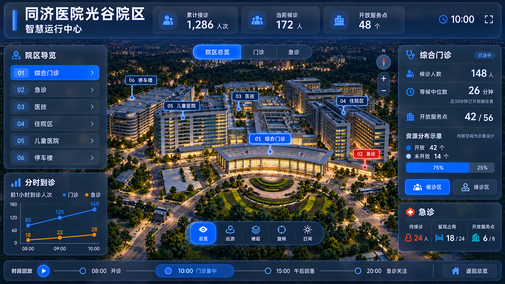
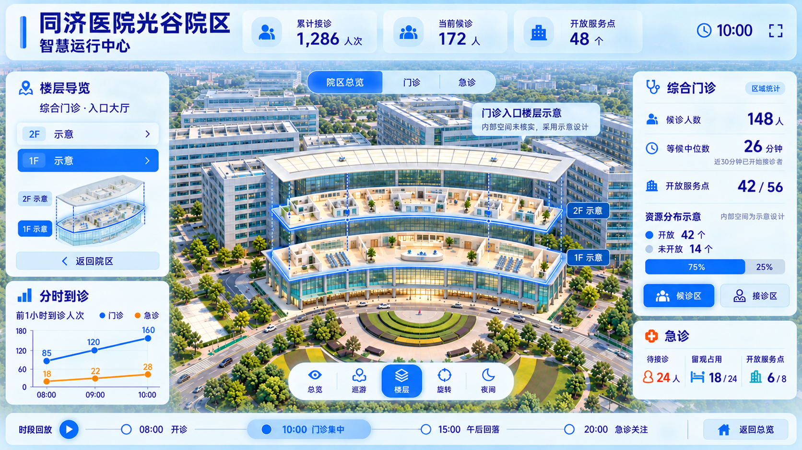
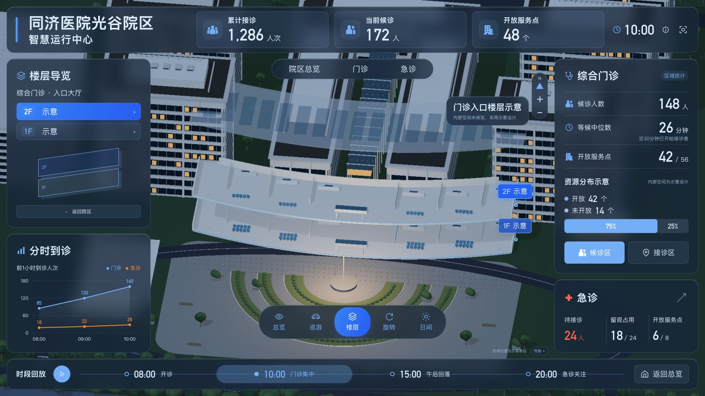
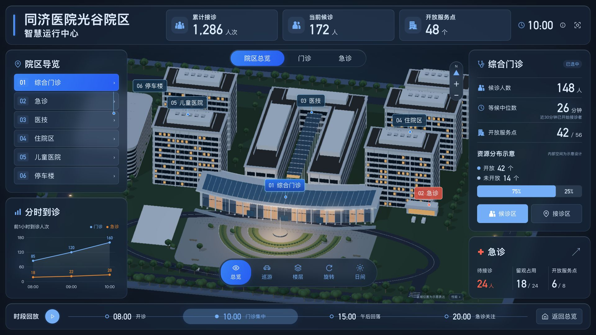
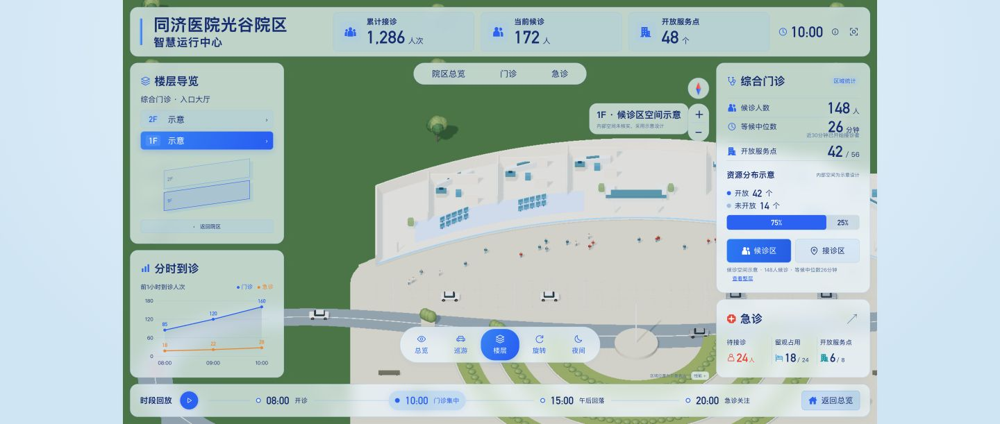
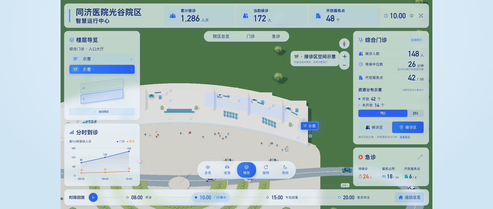
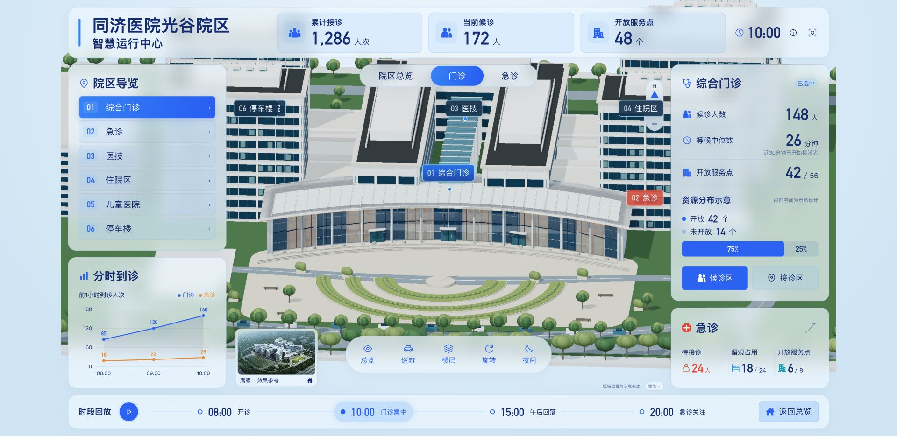

# Hospital Twin · 同济医院三维智慧运行中心

以武汉同济医院光谷院区为空间参考，使用 React 19、TypeScript、Three.js 与 Blender MCP 制作的三维空间智慧运行大屏：院区总览 → 建筑导览 → 门诊楼层展开 → 候诊/接诊分区下钻。

**[在线体验 →](https://xxcool.github.io/hospital-twin/)** · [本地运行](#本地运行) · [项目结构](#项目结构) · [设计方案说明](docs/design/方案说明.md) · [三维资产制作](tools/tripo/README.md)

> 非医院官方项目。运行指标与患者分布均为模拟数据，内部空间采用示意设计；建筑尺寸根据参考资料估计，不用于实际导航、医疗或运营决策。

## 设计效果图

以下为已确认的 **AI 设计终稿与视觉目标**。当前实时页面的三维模型与材质仍有精细度差距，实际运行画面在下一节单独展示；详见 [设计与方案说明](docs/design/方案说明.md)。


<details>
<summary>查看夜间总览与楼层展开的 AI 设计终稿</summary>

| 夜间总览 · 设计目标                                               | 楼层与分区展开 · 设计目标                                               |
| ----------------------------------------------------------------- | ----------------------------------------------------------------------- |
|  |  |

三张唯一有效终稿及确认记录见 [docs/design/day-night-v2](docs/design/day-night-v2/效果图说明.md)。

</details>

## 实际运行效果

以下图片均来自当前代码在真实浏览器中的运行页面，使用同一演示规划。点击图片可查看完整画面。

| 日间院区总览                                                                                                      | 门诊 1F/2F 楼层展开                                                                                             | 20:00 夜间运行情境                                                                                            |
| ----------------------------------------------------------------------------------------------------------------- | --------------------------------------------------------------------------------------------------------------- | ------------------------------------------------------------------------------------------------------------- |
| [](docs/images/campus-overview-2026-10-26.png) | [](docs/verification/runtime-fit-floor.png) | [](docs/verification/runtime-fit-night.png) |
| 门急诊分布、时段回放与建筑联动                                                                                    | 门诊 1F / 2F 空间展开与楼层结构                                                                                 | 20:00 夜间光影、急诊接诊与服务趋势                                                                            |

### 细分空间与服务定位

| 候诊区分区定位                                                                                  | 接诊区分区定位                                                                                            | 门诊入口弧形近景                                                                                                          |
| ----------------------------------------------------------------------------------------------- | --------------------------------------------------------------------------------------------------------- | ------------------------------------------------------------------------------------------------------------------------- |
| [](docs/verification/zone-waiting.png) | [](docs/verification/zone-consultation.png) | [](docs/verification/runtime-connected-entrance.png) |
| 一层候诊大厅空间高亮与服务负载                                                                  | 二层接诊诊区定位与资源配置                                                                                | 弧形玻璃幕墙入口与下钻视角切换                                                                                            |

## 交互体验

- **空间选择与数据联动**：从左侧导航或直接点击三维建筑，相机平滑过渡取景，右侧面板同步切换对应建筑的运行指标；总览、门诊、急诊、住院等具备独立观察视角。
- **逐层下钻到服务分区**：门诊入口支持 1F / 2F 示意楼层展开。候诊区与接诊区具备各自的三维定位与高亮边界，形成“院区 → 建筑 → 楼层 → 分区”的四级空间上下文。
- **四时段演示与日夜情境**：预设 08:00 开诊、10:00 门诊高峰、15:00 午后回落、20:00 急诊重点四个演示时段；切换时段时数值与折线平滑过渡，20:00 自动联动深蓝夜景与泛光照明。
- **智能标签与遮挡避让**：空间标签基于正交射线检测，当标签被其他建筑阻挡时自动剔除隐藏；同一位置标签根据屏幕密度动态避让，超出安全区自动收起。
- **大屏比例等比自适应**：基于 1920 × 1080 逻辑画布，通过 ResizeObserver 统一等比居中缩放；场景裁切边界严格对齐半透明面板外沿，避免非 16:9 视口溢出或越界。
- **多模式运镜与观察工具**：提供院区总览复位、自动巡游、连续旋转、楼层展开、指南针重置与步进缩放。

## 本地运行

建议使用 Node.js 22.12+ 与 npm。前端不依赖外部后端接口，无需 API 密钥。

```bash
git clone https://github.com/Xxcool/hospital-twin.git
cd hospital-twin
npm ci
npm run dev
```

打开终端提示的本地地址（默认是 `http://127.0.0.1:5173/`）。

| 命令                   | 用途                                          |
| ---------------------- | --------------------------------------------- |
| `npm run dev`          | 启动本地 Vite 开发服务                        |
| `npm run typecheck`    | TypeScript 类型检查与未使用符号验证           |
| `npm run lint`         | ESLint 代码规范与 React Hooks 检查            |
| `npm run format:check` | 检查源码与配置 Prettier 格式                  |
| `npm run format`       | 自动格式化源码与配置                          |
| `npm test`             | 验证模拟数据、资源分区守恒与标签布局/遮挡规则 |
| `npm run build`        | 类型检查并打包生产构建（`dist/`）             |
| `npm run preview`      | 本地预览生产构建产物                          |

## Blender MCP 与模型资产

可编辑源场景位于 [`assets/blender/tongji-current.blend`](assets/blender/tongji-current.blend)，通过无头 Blender MCP 实现模型编辑、材质整理与 GLB 自动导出。

- **建筑体量与布局**：依据航拍与实景照片，构建门诊、急诊、医技、住院区、儿童医院和停车楼的空间拓扑。
- **门诊弧形曲线**：严格按确认近景修正为“中部向后退、两端向前伸”的弧形幕墙，搭配连续弧形入口铺地消除模型接缝。
- **楼层与分区绑定**：通过模型对象的 `floorId` 和 `zoneId` 属性与前端状态直接绑定，支持独立展开、透明度过滤与相机包围盒适配。
- **环境与氛围道具**：包含 13 辆道路车辆与 36 名行人静态资产，补充院区生活氛围；模型材质按日夜双色调调优。
- **Tripo 制作准备**：资产拆分资料位于 [`tools/tripo/`](tools/tripo/README.md)，包含 12 个独立资产包 GLB 与库配置，供后续高精度单体迭代使用。

## 项目结构

```text
src/App.tsx                 # 应用根组件：大屏画布自适应、时段驱动与交互协调
src/components/             # 界面组件：AnimatedNumber、Icon、Trend 折线图
src/scene/                  # Three.js 三维场景模块
  ├── CampusScene.tsx       # 场景生命周期、渲染调度与 DOM 标签绑定
  ├── camera.ts             # 建筑包围盒自适应取景、缓动过渡与巡游控制
  ├── lighting.ts           # 日间天光与夜间点光源、色调渐变管理
  ├── floors.ts             # 门诊 1F/2F 楼层展开高度与动画计算
  ├── labels.ts             # 空间标签投影、正交射线遮挡剔除与避让算法
  └── resources.ts          # 模型与贴图实例缓存与安全销毁
src/data/                   # 演示数据模型、时段快照与单元测试
public/scene/               # 网页运行时 GLB（tongji-current.glb）与 manifest.json
assets/blender/             # 可编辑 Blender 源工程、贴图与 scene-spec 制作规格
docs/design/                # AI 设计终稿、日夜规范与历史确认记录
docs/verification/          # 浏览器实际运行截图与边界验证记录
tools/tripo/                # 三维资产拆分清单、提示词与单体制作图册
.github/workflows/          # GitHub Actions 自动化质量检查与 Pages 部署工作流
```

## 质量验证

项目包含完善的自动化质量检查与人工比对验证：

- **数据与计算契约**：`src/data/model.test.ts` 验证各时段总览指标等于各区域分项求和，资源分区严格守恒，时段快照递增。
- **标签布局与视线剔除**：`src/scene/labels.test.ts` 验证同坐标标签空间避让、安全区边界限制以及正交射线穿透遮挡建筑时的自动隐藏。
- **工程规范合规**：TypeScript 严苛类型检查、ESLint React Hooks 规范与 Prettier 风格自动化检查。
- **边界核验**：详情参见 [当前设计与制作进度说明](docs/design/方案说明.md)。

## 参考资料与使用说明

本演示基于公开照片与资料进行外观研究与三维原型探索，其权利归原权利人所有。AI 设计图仅作视觉目标参考，内部空间与运行数据均为演示设定，不代表同济医院官方立场或实际运营决策。

## 👨‍💻 作者 (Author)

- **Xxcool** - [GitHub (@Xxcool)](https://github.com/Xxcool) · [掘金技术主页](https://juejin.cn/user/4265760845468296/posts)

## 📄 开源许可 (License)

本项目遵循 [MIT License](LICENSE) 开源协议。

