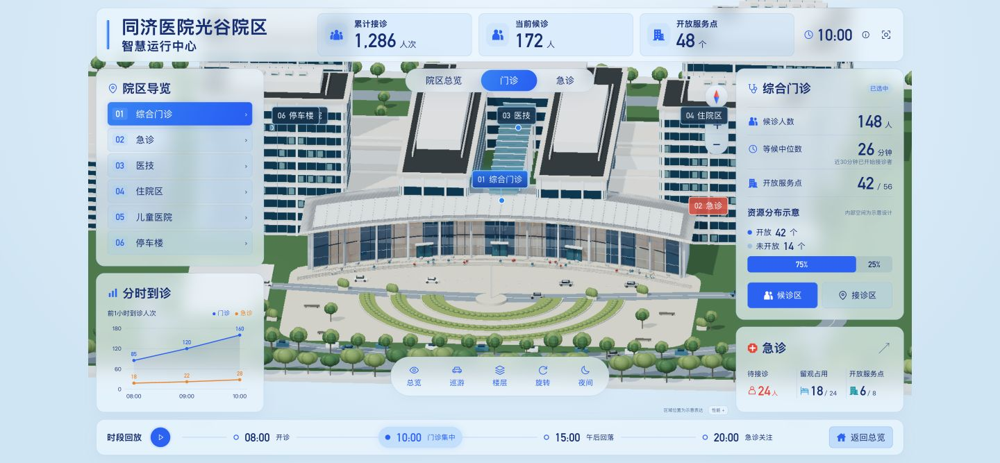

# 同济医院光谷院区 · 三维智慧运行中心

基于 React、TypeScript、Three.js 与 Blender 的院区可视化演示。通过三维空间选择、楼层展开和时段回放，联动展示门急诊服务压力与资源分布。

**[在线体验](https://xxcool.github.io/tongji-hospital-3d-dashboard)** · [设计与实现进度](docs/design/方案说明.md) · [三维资产制作资料](tools/tripo/README.md)

> 非医院官方项目。运行指标均为模拟数据，内部空间采用示意设计；建筑尺寸根据参考资料估计，不用于实际导航、医疗或运营决策。

## 实际运行预览

[](https://xxcool.github.io/tongji-hospital-3d-dashboard)

上图为开发过程中的实际网页截图。当前模型仍在迭代，设计效果图另见[设计资料](docs/design/方案说明.md)，不作为已实现品质展示。

## 可以体验什么

| 功能 | 交互说明 |
|---|---|
| 院区导览 | 选择综合门诊、急诊、医技、住院区、儿童医院与停车楼，联动视角和区域信息 |
| 楼层与分区 | 展开门诊 1F / 2F 示意楼层，分别定位候诊区与接诊区 |
| 场景操作 | 支持巡游、旋转、缩放、返回总览及日夜切换 |
| 时段回放 | 切换 08:00、10:00、15:00、20:00，联动模拟指标与趋势 |
| 大屏适配 | 基于 1920 × 1080 逻辑画布等比缩放，适合桌面浏览器查看 |

## 本地运行

建议使用 Node.js 22.12+ 及 npm。前端不依赖真实医院接口，不需要 API 密钥。

```bash
git clone https://github.com/Xxcool/tongji-hospital-3d-dashboard.git
cd tongji-hospital-3d-dashboard
npm ci
npm run dev
```

打开终端提示的地址，默认是 `http://127.0.0.1:5173/`。

| 命令 | 用途 |
|---|---|
| `npm run dev` | 启动开发服务 |
| `npm run typecheck` | TypeScript 类型检查 |
| `npm test` | 验证模拟数据与资源分配规则 |
| `npm run build` | 类型检查并生成 `dist/` |
| `npm run preview` | 本地预览生产构建 |

## GitHub Pages 部署

项目已上线：**[xxcool.github.io/tongji-hospital-3d-dashboard](https://xxcool.github.io/tongji-hospital-3d-dashboard)**。

仓库 Pages 来源使用 **GitHub Actions**。PR 自动执行测试与构建；合入 `main` 后，[部署工作流](.github/workflows/pages.yml) 自动发布 `dist/`，也支持手动触发。不要改成直接发布 `main` 分支源码的模式。

构建时指定仓库子路径，模型加载使用 Vite 的 `BASE_URL`。本地复现线上路径：

```bash
npm run build -- --base=/tongji-hospital-3d-dashboard/
npm run preview -- --base=/tongji-hospital-3d-dashboard/
```

访问预览服务下的 `/tongji-hospital-3d-dashboard/`。只发布网页构建产物，Blender 源文件、设计资料与 Tripo 工具不会进入站点。

## 项目结构

```text
├── src/                  # React 界面、Three.js 场景、模拟数据与测试
├── public/scene/         # 网页 GLB 与场景绑定清单
├── public/media/         # 网页静态图片
├── assets/blender/       # 可编辑模型、纹理与制作规格
├── docs/design/          # 设计参考、业务快照与当前进度
├── docs/research/        # 调研与范围依据
├── docs/verification/    # 网页验证截图
├── tools/tripo/          # 拆件、生成输入、队列与制作脚本
├── .github/workflows/    # 测试、构建与 Pages 部署
└── vite.config.ts        # Vite 配置
```

## 三维资产与当前边界

可编辑场景为 [`assets/blender/tongji-current.blend`](assets/blender/tongji-current.blend)。通过无头 Blender MCP 制作与导出，保留业务对象、楼层、分区 ID，再更新网页 GLB 和绑定清单。

Tripo 资料位于 [`tools/tripo`](tools/tripo/README.md)，包含拆件 `.blend` / `.glb`、参考图、任务草案与生成说明。当前尚未提交 Tripo 生成，精细化模型不会自动替换线上资产。

需要重新拆分时，在 Blender MCP 中执行 `tools/tripo/prepare_assets.py`，显式传入仓库根目录 `PROJECT_ROOT`。仓库支持从保存场景继续编辑，尚不支持从空场景完整重建全部资产。

当前建筑细节、材质和内部设施与设计目标仍有差距。未核实的背面与内部布局均为示意；目标设备性能需单独验证。

## 参考资料与使用说明

照片、建筑效果图及参考资料用于本演示的外观研究，其权利归原权利人；未独立核实第三方素材的再分发或商业使用许可。AI 生成图仅作设计参考，不能视为真实建筑资料。医院名称与标识不表示官方授权或合作。

本仓库未授予第三方参考素材额外许可，也未声明采用某种开源许可证。
