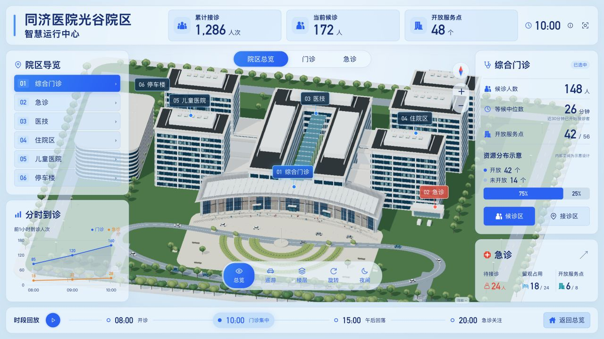

# 同济医院光谷院区 · 三维智慧运行中心

一个可以从院区走进楼层、从建筑定位到服务分区的三维运行大屏。以门急诊服务压力与资源分布为主线，将建筑选择、镜头移动、指标面板和时段变化连接起来。

**[在线体验](https://xxcool.github.io/tongji-hospital-3d-dashboard)** · [设计与实现进度](docs/design/方案说明.md) · [三维资产制作资料](tools/tripo/README.md)

> 非医院官方项目。运行指标均为模拟数据，内部空间采用示意设计；建筑尺寸根据参考资料估计，不用于实际导航、医疗或运营决策。

## 实际运行预览

[](https://xxcool.github.io/tongji-hospital-3d-dashboard)

上图为 2026-10-26 在线演示的院区总览实拍截图。当前模型仍在迭代，设计效果图另见[设计资料](docs/design/方案说明.md)，不作为已实现品质展示。

## 从院区空间理解运行状态

医院里的运行指标都对应着具体空间：候诊人数属于哪个区域，接诊资源集中在哪里，门诊与急诊在不同时段承受怎样的服务压力？这个项目把这些问题放进同一个可交互院区，探索三维场景如何帮助理解数据。

以武汉同济医院光谷院区的建筑外观和空间关系为参考，围绕门急诊构建演示。医技、住院区、儿童医院和停车楼提供空间导览；运行指标集中在门诊与急诊，便于形成清晰的观察主线。

## 值得关注的设计

### 空间选择与数据保持同一个上下文

从左侧导览或三维建筑选择区域，相机随之定位，右侧切换对应信息。总览、门诊与急诊具有不同观察视角，让“看哪里”和“看什么数据”形成连续操作。

### 从院区下钻到楼层，再定位服务分区

门诊入口支持 1F / 2F 示意楼层展开。候诊区与接诊区有各自的三维定位，可从建筑外观进一步查看内部服务空间，体现院区、建筑、楼层、分区的层级关系。

### 用时段变化讲清门急诊的不同关注点

08:00 开诊、10:00 门诊集中、15:00 午后回落、20:00 急诊关注，构成四个演示情境。切换时段后，总览指标、区域详情和到诊趋势同步变化；20:00 联动夜间场景，便于对照白天与晚间的服务状态。

### 三维场景可以继续编辑和扩展

仓库包含 Blender 源场景、网页 GLB、楼层与分区绑定，以及模型拆分资料。建筑外观、室内示意和交互定位分别维护，后续可以逐件精修资产，并保留已有空间交互。

### 为大屏观看组织界面

采用 1920 × 1080 逻辑画布等比适配，搭配日夜主题、半透明面板、数字与趋势过渡。巡游、旋转、缩放和返回总览提供不同观看方式。

## 建议这样体验

1. 从**院区总览**进入，依次选择门诊、急诊及其他建筑，观察镜头与详情面板联动。
2. 进入**楼层**，切换 1F / 2F，再点击**候诊区 / 接诊区**查看空间定位。
3. 使用底部**时段回放**，对照 10:00 与 20:00 的候诊、开放服务点及到诊趋势。
4. 切换**日夜模式**，或开启**巡游 / 旋转**，查看院区不同角度。

## 技术实现

| 技术 | 在项目中的职责 |
|---|---|
| React + TypeScript | 面板、导航、交互状态及数据类型 |
| Three.js | GLB 场景加载、相机过渡、建筑选择与楼层展示 |
| Blender / Blender MCP | 建筑与环境制作、材质整理、拆件与模型导出 |
| Vite | 本地开发与生产构建 |
| 统一时段快照 | 场景和面板共用演示状态，总览由区域分项计算 |

## 本地运行

建议使用 Node.js 22.12+ 及 npm。前端不依赖真实医院接口，不需要 API 密钥。

```bash
git clone https://github.com/Xxcool/tongji-hospital-3d-dashboard.git
cd tongji-hospital-3d-dashboard
npm ci
npm run dev
```

打开终端提示的地址，默认是 `http://127.0.0.1:5173/`。

| 命令 | 用途 |
|---|---|
| `npm run dev` | 启动开发服务 |
| `npm run typecheck` | TypeScript 类型与未使用符号检查 |
| `npm run lint` | 通用代码规范与 React Hooks 检查 |
| `npm run format:check` | 检查源码与配置格式 |
| `npm run format` | 格式化源码与配置 |
| `npm test` | 验证模拟数据、资源分配和标签布局/遮挡规则 |
| `npm run build` | 类型检查并生成 `dist/` |
| `npm run preview` | 本地预览生产构建 |

场景逻辑位于 `src/scene/`：`CampusScene.tsx` 管理生命周期，`camera.ts`、`lighting.ts`、`floors.ts`、`labels.ts` 分别负责取景、主题、楼层和空间标签。ESLint 使用 Babel 解析 TS/TSX，类型检查由 TypeScript 7 负责；CI 同时运行规范、格式、测试和构建检查。

## 项目结构

```text
├── src/                  # React 界面、Three.js 场景、模拟数据与测试
├── public/scene/         # 网页 GLB 与场景绑定清单
├── public/media/         # 网页静态图片
├── assets/blender/       # 可编辑模型、纹理与制作规格
├── docs/design/          # 设计参考、业务快照与当前进度
├── docs/research/        # 调研与范围依据
├── docs/verification/    # 网页验证截图
├── tools/tripo/          # 拆件、生成输入、队列与制作脚本
├── .github/workflows/    # 自动测试与构建
└── vite.config.ts        # Vite 配置
```

## 三维资产与当前边界

可编辑场景为 [`assets/blender/tongji-current.blend`](assets/blender/tongji-current.blend)。通过无头 Blender MCP 制作与导出，保留业务对象、楼层、分区 ID，再更新网页 GLB 和绑定清单。

Tripo 资料位于 [`tools/tripo`](tools/tripo/README.md)，包含拆件 `.blend` / `.glb`、参考图、任务草案与生成说明。当前尚未提交 Tripo 生成，精细化模型不会自动替换线上资产。

详细拆分方法与生成约束见[制作说明](tools/tripo/README.md)。

当前建筑细节、材质和内部设施与设计目标仍有差距。未核实的背面与内部布局均为示意；目标设备性能需单独验证。

## 参考资料与使用说明

照片、建筑效果图及参考资料用于本演示的外观研究，其权利归原权利人；未独立核实第三方素材的再分发或商业使用许可。AI 生成图仅作设计参考，不能视为真实建筑资料。医院名称与标识不表示官方授权或合作。

本仓库未授予第三方参考素材额外许可，也未声明采用某种开源许可证。
